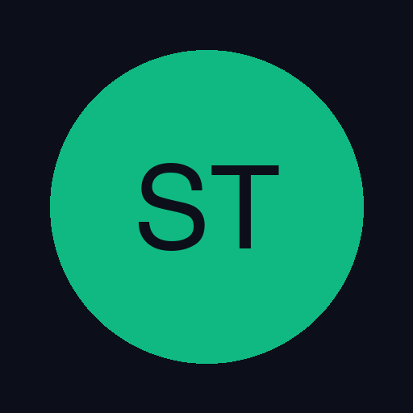

# Diluizione Spese Tech

Tracker per l'ammortamento degli acquisti tecnologici. Calcola il costo giornaliero di ogni prodotto e mostra il progresso verso la soglia di 0.25€/giorno.



## Funzionalità

- **Dashboard KPI**: spesa totale attiva, costo medio/giorno, prodotti ammortizzati, prossimo traguardo
- **Grafici**: ranking costo/giorno e spesa per categoria
- **Gestione prodotti**: aggiungi, modifica, ritira, elimina
- **Filtri e ordinamento**: per stato, categoria, costo/giorno, prezzo, durata, progresso
- **Sezione ritirati**: statistiche dettagliate sui prodotti ritirati
- **Import/Export**: JSON e CSV
- **Sincronizzazione**: tramite GitHub Gist segreto, con cifratura end-to-end opzionale (passphrase)
- **Backup locali**: copia automatica prima di ogni sostituzione dei dati
- **PWA**: installabile su iOS, Android e desktop, funziona offline

## Setup sincronizzazione

### 1. Crea un token GitHub fine-grained

1. Vai su [github.com/settings/personal-access-tokens/new](https://github.com/settings/personal-access-tokens/new)
2. Dai un nome al token e imposta una **scadenza** (es. 90 giorni)
3. In **Permissions → Account permissions** imposta **Gists** su **Read and write**, e nient'altro
4. Genera e copia il token

### 2. Configura nell'app

1. Clicca l'icona ⚙️ nell'header
2. Incolla il token nel campo "Token PAT"
3. (Opzionale) Inserisci un Gist ID esistente
4. (Consigliato) Scegli una **passphrase**: i dati vengono cifrati nel browser prima di essere caricati
5. Clicca **"Configura"**

L'app crea automaticamente un Gist segreto se non ne fornisci uno. Sugli altri dispositivi usa lo stesso Gist ID e la stessa passphrase.

### Gist segreto e cifratura

Un Gist "secret" non compare nelle ricerche né nel tuo profilo, ma **chiunque abbia il link può leggerlo** e GitHub ne conserva tutte le versioni precedenti. Con la passphrase il Gist contiene solo dati cifrati (AES-GCM 256, chiave derivata con PBKDF2-SHA256): senza la passphrase non sono leggibili, nemmeno da GitHub. **Conservala**: se la perdi, i dati del Gist non si possono recuperare (quelli nel browser restano).

Se attivi la cifratura su un Gist esistente, le sue versioni precedenti restano in chiaro: per eliminarle crea un nuovo Gist (Disconnetti, elimina il vecchio Gist su GitHub, poi Configura senza Gist ID).

### Sincronizzazione tra dispositivi

Ogni sync legge prima il Gist: se sono cambiati solo i dati remoti li scarica, se sono cambiati solo quelli locali li carica, se sono cambiati entrambi li **unisce prodotto per prodotto** (vince la modifica più recente; un prodotto eliminato non ricompare). Prima di ogni sostituzione viene salvata una copia locale, recuperabile con **"Scarica ultimo backup"** e reimportabile con "Importa JSON".

## Installazione come PWA

### iOS (Safari)
1. Apri l'app nel browser
2. Tocca il pulsante **Condividi** (quadrato con freccia)
3. Seleziona **"Aggiungi alla schermata Home"**

### Android (Chrome)
1. Apri l'app nel browser
2. Tocca il menu ⋮
3. Seleziona **"Installa app"** o **"Aggiungi a schermata Home"**

### Desktop (Chrome/Edge)
1. Apri l'app nel browser
2. Clicca l'icona di installazione nella barra degli indirizzi
3. Conferma l'installazione

## Struttura del progetto

```
diluizione-spese-tech/
├── index.html          # Markup e Content Security Policy
├── theme.js            # Applica il tema prima del primo paint
├── app.js              # Logica dell'app
├── app.css             # Stili
├── manifest.json       # PWA manifest
├── sw.js               # Service worker per offline
├── fonts/              # Font DM Sans e JetBrains Mono (SIL OFL 1.1), serviti localmente
├── scripts/check.mjs   # Controlli statici (sintassi, manifest, asset)
├── tests/smoke.mjs     # Smoke test Playwright
├── .github/workflows/  # CI su ogni PR e push su main
├── icons/
│   ├── icon-192.png    # Icona 192x192
│   └── icon-512.png    # Icona 512x512
└── README.md
```

## Sviluppo e CI

```bash
npm ci
npm run lint                         # controlli statici
npx playwright install chromium      # solo la prima volta
npm test                             # smoke test nel browser
```

La Content Security Policy non ammette `'unsafe-inline'`: niente `<script>`/`<style>` inline, niente handler `on*=` e niente attributi `style=`. Usa `data-action`/`data-change` per gli eventi e `data-css`, `hidden` o classi CSS per gli stili; `npm run lint` lo verifica.

La CI (GitHub Actions) esegue gli stessi controlli su ogni pull request e su `main`. Il deploy avviene automaticamente tramite GitHub Pages a ogni push su `main`.

## Privacy

- Il sito su GitHub Pages è pubblico, ma **non contiene dati personali**: una nuova installazione parte vuota
- I dati dei prodotti risiedono nel **localStorage** del browser e, se attivi la sync, in un **Gist segreto** del tuo account GitHub (cifrato, se imposti una passphrase)
- Token e passphrase vengono salvati solo nel localStorage del browser e inviati solo a `api.github.com` (la passphrase mai: serve solo a cifrare localmente)
- L'app contatta **solo** il proprio sito e, per la sync, `api.github.com`: niente analytics, CDN o font esterni (la CSP lo impone)
- Il localStorage è condiviso da tutti i siti GitHub Pages dello stesso account (`<utente>.github.io`): pubblica qui solo progetti di cui ti fidi, oppure usa un dominio dedicato
